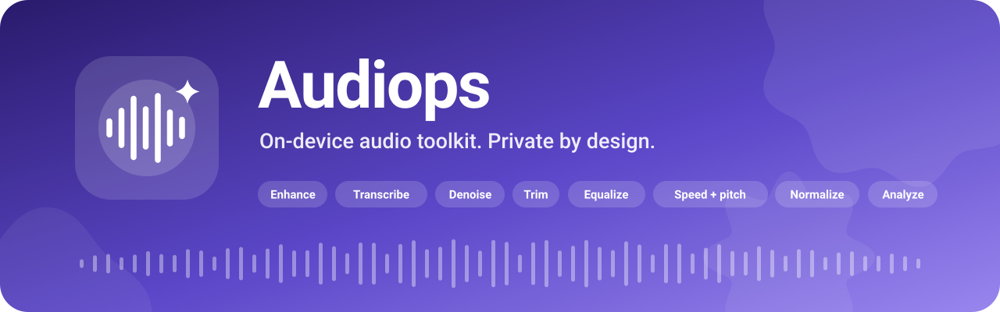
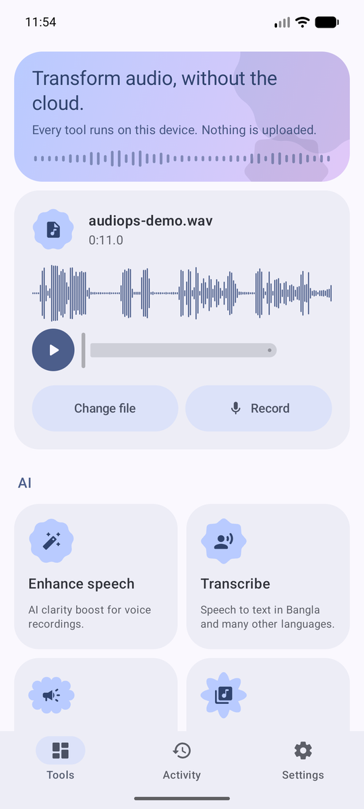
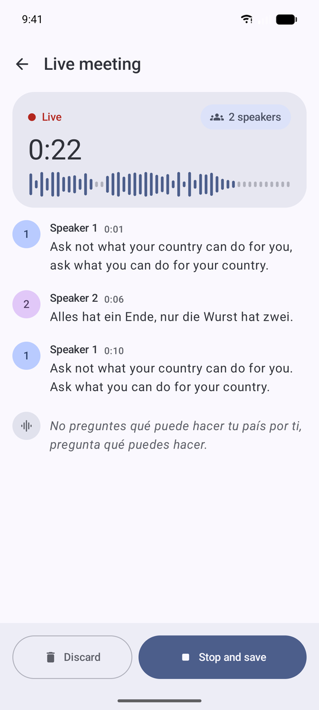
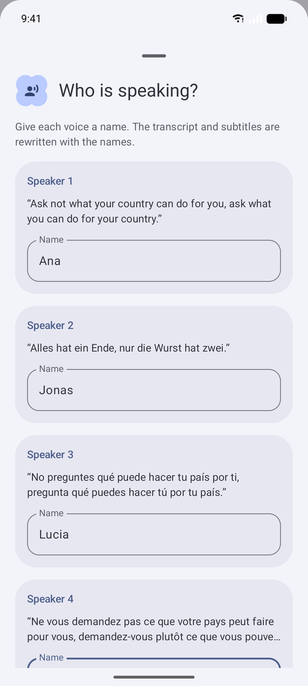
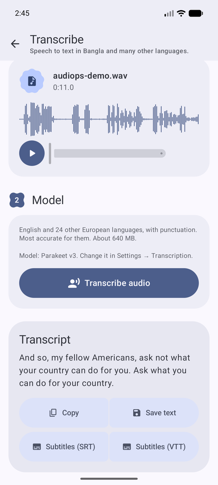
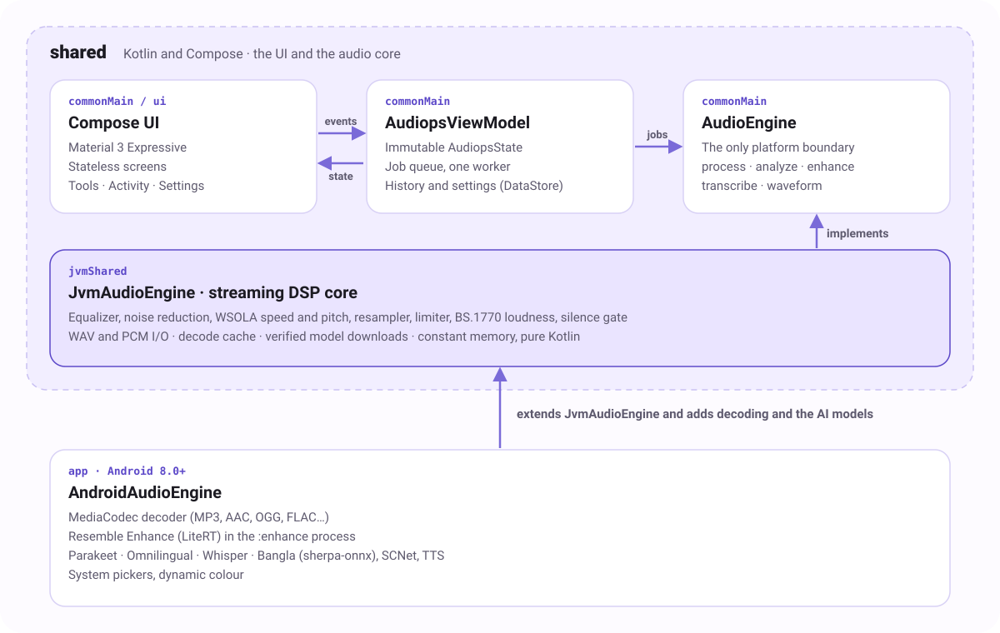

<div align="center">



<br>

[](https://github.com/sayedshaun/audiops/actions/workflows/android.yml) [](https://github.com/sayedshaun/audiops/releases) [](LICENSE)   

**On-device audio AI: transcribe meetings with speakers, speak text, enhance, separate, edit and analyze audio, entirely on your phone.**<br>
In Bangla and well over a thousand other languages. Nothing you open is uploaded; AI models download once, then run offline.

[**Download**](https://github.com/sayedshaun/audiops/releases/latest) · [Features](#features) · [Models](#models) · [Screenshots](#screenshots) · [Build from source](#build-from-source) · [Contributing](CONTRIBUTING.md)

</div>

---

## Why Audiops

- **Private by design.** Audio never leaves your device. The app has no accounts, no analytics and no server. It asks for the microphone only when you tap Record, and for notifications only to show job progress.
- **Many languages, not English first.** Pick the language and Audiops offers the models that handle it: a dedicated Bangla model, punctuated text for 25 European languages, over 1,600 languages with sentences at every pause, and text to speech in 37. Features that would only work in English are left out.
- **One toolkit, not ten apps.** Fifteen tools behind one consistent interface, with a queue so several jobs can run while you keep working. Choose a file and Audiops says what it sounds like and suggests the tool to try.
- **Built for long recordings.** Every tool streams audio in blocks, so a two-hour lecture uses the same memory as a voice note.
- **Open source, one codebase.** Kotlin and Compose (Compose Multiplatform libraries), built for Android.

## Features

| | Tool | What it does |
| :-: | --- | --- |
| ✨ | **Enhance speech** | **Fast** mode removes noise in seconds (DPDFNet); **Studio** mode restores voice recordings with [Resemble Enhance](https://huggingface.co/SayedShaun/resemble-enhance-litert) (LiteRT, mobile export), which takes minutes on a phone. |
| 🎼 | **Separate music** | Splits a song into vocals, an instrumental, drums, bass and other instruments ([SCNet](https://github.com/starrytong/SCNet), int8 ONNX through ONNX Runtime). |
| 🗣️ | **Transcribe** | Speech to text in Bangla, Urdu and many other languages, with punctuation for English and European languages and a sentence at each pause for the rest; optionally tells the speakers apart, and you can name them afterwards ([Parakeet v3](https://huggingface.co/csukuangfj/sherpa-onnx-nemo-parakeet-tdt-0.6b-v3-int8), [Omnilingual ASR](https://huggingface.co/csukuangfj/sherpa-onnx-omnilingual-asr-1600-languages-300M-ctc-int8-2025-11-12), [Whisper Tiny](https://huggingface.co/ippocode/indic-asr-onnx/tree/1f6243ec6dffc4de2db84fe1446576d1ff52c252/models/whisper-tiny) and [Bangla Zipformer](https://huggingface.co/SayedShaun/bangla-zipformer-onnx); sherpa-onnx). |
| 👥 | **Live meeting** | Put the phone on the table: it transcribes the meeting as people speak and tells the speakers apart, with the screen off if you like. Saves the transcript (with speakers), subtitles and the recording. Name the speakers afterwards, and Audiops recognises those voices in later meetings (voice prints stay on the phone) ([Silero VAD](https://github.com/snakers4/silero-vad) finds speech, [CAM++](https://github.com/modelscope/3D-Speaker) voice embeddings tell speakers apart, and the transcription model chosen for the language writes it down; sherpa-onnx). |
| 📣 | **Text to speech** | Turn text into speech in 37 languages, on your phone ([Supertonic 3](https://huggingface.co/Supertone/supertonic-3) through sherpa-onnx for 31 of them, the default; [PocketTTS](https://huggingface.co/litert-community/pocket-tts) through MediaPipe for English, French, German, Spanish, Italian, Portuguese and Dutch; [Piper](https://github.com/rhasspy/piper) voices through sherpa-onnx for 20 more; ten [Kokoro](https://huggingface.co/hexgrad/Kokoro-82M) voices for English, US and UK). |
| 🌊 | **Noise reduction** | [DPDFNet](https://github.com/ceva-ip/DPDFNet) AI speech enhancement (48 kHz) removes background noise on your phone. |
| ⏸️ | **Remove silence** | Shortens long pauses and keeps natural padding. |
| ✂️ | **Trim** | Keep the part you need, chosen on the waveform. |
| 🌗 | **Fade** | Smooth fade in and fade out. |
| 🔊 | **Volume** | Peak normalization, loudness normalization to −14/−16/−23 LUFS (ITU-R BS.1770) with a look-ahead limiter, or plain gain. |
| ⏩ | **Speed and pitch** | 0.5×–2× tempo without changing pitch, ±12 semitones without changing tempo. |
| 🎚️ | **Equalizer** | Voice clarity, bass boost, treble boost, warm, remove rumble and telephone presets. |
| 🔁 | **Convert** | Anti-aliased resampling to 8, 16, 22.05, 44.1 or 48 kHz. |
| 📊 | **Analyze** | Integrated loudness, peak, RMS, clipping, silence and DC offset, and the main sounds heard (speech, music, noise and over 500 more AudioSet classes). |

Open MP3, AAC/M4A, WAV, FLAC, OGG and anything else your device decodes. Results are saved as WAV (mono, 16-bit), M4A or Opus; the format is chosen when you save.

**And around the tools:** a suggestion for each recording (speech → Transcribe, noisy speech → Enhance, music → Separate), waveform previews and playback, an Activity tab with the job queue and history, light, dark and pure-black themes, dynamic color on Android 12+, predictive back, haptics, screen-reader labels and large touch targets.

## Models

The AI tools, noise reduction and the sound suggestions use machine-learning models. Every other tool is classic signal processing written in Kotlin, with nothing to download.

| Tool (option) | Model | Runtime | Files | Download | License |
| --- | --- | --- | --- | --: | --- |
| **Separate music** | [SCNet](https://github.com/starrytong/SCNet) (starrytong), int8 ONNX export by [audiojs](https://huggingface.co/audiojs/scnet) | ONNX Runtime, CPU | 1 file | ~13 MB | MIT (trained on MUSDB18-HQ, academic-use data; see Licences) |
| **Enhance speech** | [Resemble Enhance](https://huggingface.co/SayedShaun/resemble-enhance-litert) `mobile` set: INT8 dynamic networks + a vocoder re-exported for XNNPACK (FP16) | [LiteRT](https://ai.google.dev/edge/litert), CPU | 5 networks + mel filter bank | ~570 MB | MIT |
| **Noise reduction** (Android) | [DPDFNet](https://huggingface.co/Ceva-IP/DPDFNet) `dpdfnet2_48khz_hr`, ONNX (sherpa-onnx export) | sherpa-onnx, CPU | model | ~11 MB | Apache 2.0 (Ceva) |
| **Text to speech** (31 languages: the default voices) | [Supertonic 3](https://huggingface.co/Supertone/supertonic-3) (Supertone), int8, sherpa-onnx format hosted at [SayedShaun/supertonic-3-sherpa-onnx-int8](https://huggingface.co/SayedShaun/supertonic-3-sherpa-onnx-int8) | sherpa-onnx, CPU | 7 files, shared by every language | ~145 MB | OpenRAIL-M (Supertone), with use restrictions |
| **Text to speech** (English, French, German, Spanish, Italian, Portuguese, Dutch) | [PocketTTS 100M](https://huggingface.co/litert-community/pocket-tts/tree/03f949ec418ccd4d153008f7ef9c58c754cc0616) (Kyutai), INT8, one file per language | [MediaPipe](https://ai.google.dev/edge/mediapipe) `TextToSpeech`, CPU | 1 file | 125–163 MB per language | CC BY 4.0 (Kyutai) |
| **Text to speech** (20 more languages) | [Piper](https://github.com/rhasspy/piper) voices, ONNX exports by [k2-fsa](https://huggingface.co/csukuangfj) | sherpa-onnx + eSpeak NG (GPL-3.0), CPU | model, tokens | ~63 MB per voice | CC0, public domain or CC BY 4.0, per voice |
| **Text to speech** (Kokoro, English US and UK) | [Kokoro-82M v1.0](https://huggingface.co/csukuangfj/kokoro-int8-multi-lang-v1_0/tree/57adb37fc0e8d4bd430cfc1b8f8c2294945b9af2) (hexgrad), INT8 | sherpa-onnx + espeak-ng, CPU | model, voices, tokens, lexicons | ~155 MB | Apache 2.0 |
| **Live meeting, speaker labels, sentences** (speech detection) | [Silero VAD v5](https://huggingface.co/deepghs/silero-vad-onnx/tree/193243f7d961b15e6de789d3f90cb0ee867e7b62) (Silero Team), ONNX | sherpa-onnx, CPU | 1 file | ~2 MB | MIT |
| **Live meeting, speaker labels** (speakers) | [CAM++ zh/en](https://huggingface.co/csukuangfj/speaker-embedding-models/tree/a8055d6daef723a6a4ecf4de233708575bf4994f) (Alibaba 3D-Speaker), ONNX | sherpa-onnx, CPU | 1 file | ~28 MB | Apache 2.0 |
| **Sound recognition** (suggestions, Analyze) | [Zipformer audio tagging, small](https://huggingface.co/k2-fsa/sherpa-onnx-zipformer-small-audio-tagging-2024-04-15/tree/c24f9d0fdf7d0b8c0c4f9733aa0cac51fda10c95) (k2-fsa icefall, AudioSet), INT8 | sherpa-onnx, CPU | model, labels | ~27 MB | Apache 2.0 (labels CC BY 4.0) |
| **Transcribe** (English and 24 European languages) | [Parakeet TDT 0.6B v3](https://huggingface.co/csukuangfj/sherpa-onnx-nemo-parakeet-tdt-0.6b-v3-int8/tree/ed5d745623472f97cfc2e6c2916ee248798fc5a8) (NVIDIA), INT8 transducer | sherpa-onnx, CPU | encoder, decoder, joiner, tokens | ~640 MB | CC BY 4.0 (NVIDIA) |
| **Transcribe** (other languages; Whisper Tiny fallback) | [Omnilingual ASR 300M](https://huggingface.co/csukuangfj/sherpa-onnx-omnilingual-asr-1600-languages-300M-ctc-int8-2025-11-12/tree/6abf1ece20cd2308bdb7d13cd78ec1c44fa4c094), CTC INT8 | [sherpa-onnx](https://github.com/k2-fsa/sherpa-onnx), CPU | model, tokens | ~366 MB | Apache 2.0 (Meta Platforms) |
| **Transcribe** (Whisper Tiny, about 100 languages) | [Whisper Tiny](https://huggingface.co/ippocode/indic-asr-onnx/tree/1f6243ec6dffc4de2db84fe1446576d1ff52c252/models/whisper-tiny), INT8 ONNX | sherpa-onnx, CPU | encoder, decoder, tokens | ~103 MB | MIT (OpenAI) · Apache 2.0 (ONNX export) |
| **Transcribe** (Bangla) | [Bangla Zipformer](https://huggingface.co/SayedShaun/bangla-zipformer-onnx/tree/5442ca3d447572aaa5ef6913684d8f24d6d916cc), INT8 transducer | sherpa-onnx, CPU | encoder, decoder, joiner, tokens | ~74 MB | CC BY-SA 4.0 |
| All other tools | None | Kotlin DSP | – | – | – |

### Which model runs when

- **Enhance speech** in Studio mode uses Resemble Enhance (Fast mode runs the DPDFNet noise-reduction model instead). Audio is converted to 44.1 kHz mono and processed in one-second chunks with 50% overlap through five networks: a **denoiser**, an **encoder**, a **flow-matching step** (8 midpoint steps, 16 evaluations; upstream uses 16 steps), a **decoder** and a **vocoder** that produces the waveform. Long recordings go through in 20-second windows joined with a crossfade.
- **Transcribe** and **Live meeting** start with two choices at the top of the screen: the **language** spoken, then the **model** for it. Only models that handle that language are offered, the recommended one first (Bangla → the Bangla model, the 25 European languages → Parakeet, Urdu → Whisper Tiny, everything else → Omnilingual). In the app the models are described by what they do, not by name:
  - **Parakeet v3**: English and 24 other European languages, with punctuation and capital letters. In our test (FLEURS, 25 clips per language, CPU) it made 2.5 to 4 times fewer errors than Omnilingual on English, French, Spanish and German (word error 2 to 8%) and ran about 1.7 times faster.
  - **Omnilingual ASR 300M**: over 1,600 languages. It writes no punctuation, so the recording is cut at pauses (Silero VAD, with a little audio kept on each side) and each part becomes a sentence with the language's full stop.
  - **Whisper Tiny**: about 100 languages, small and fast but less accurate. It is the only model you give a language to, from a list of about 60. It scored better than Omnilingual on Urdu in our benchmark.
  - **Bangla Zipformer**: Bangla only (cut at pauses into sentences ending in ।, beam search).
- **Speaker labels** (Transcribe's "Tell speakers apart", and every Live meeting) give each part a CAM++ voice embedding and group them by speaker. Named speakers are remembered on the phone and recognised in later transcripts.
- **Sound suggestions** run the small Zipformer AudioSet tagger over up to three 10-second windows of the chosen recording.

### Download, verification and storage

- Each model downloads **once**, on first use of its tool, over HTTPS from Hugging Face. After that the tool works fully offline.
- Every model file is pinned to a fixed revision and **verified with SHA-256** before use. When a model is updated, the old revision is deleted.
- Models live in app-private storage that is excluded from backups. See their size, or delete them, in **Settings → Storage → Downloaded models**; they download again when needed.
- **Memory:** Omnilingual, Whisper and Bangla run comfortably on any supported phone. Resemble Enhance loads one network at a time and keeps repacked weights in a file-backed cache, so it peaks at about 1.5 GB (it completes on a 4 GB emulator); 6 GB of RAM or more is comfortable. It runs in a separate process: if a phone runs out of memory, Audiops stays open and says so.

## Screenshots

<div align="center">






<sub>Tools · Live meeting · Naming speakers · Transcript with names</sub>

</div>

## Download

Get the latest build from [**Releases**](https://github.com/sayedshaun/audiops/releases/latest) and pick the file for your phone:

| Platform | File | How to install |
| --- | --- | --- |
| Android 8.0+ | `-android-arm64-v8a.apk` (almost every phone since 2017) | Open it on your phone (allow installs from your browser or file manager). Not sure? Take `-android-universal.apk`, which works everywhere but is larger. |

Every release includes `SHA256SUMS.txt`. Verify a download with `sha256sum -c SHA256SUMS.txt --ignore-missing`.

### Platform support

Audiops is an **Android 8.0+** app (arm64, ARMv7, x86_64 and x86) and opens anything your device can decode.

## Build from source

You need **JDK 17** (with `javac`) and the **Android SDK** with platform 37. Android Studio provides both.

```sh
git clone https://github.com/sayedshaun/audiops.git
cd audiops

./gradlew :app:installDebug          # Android, on a connected device or emulator
```

Point Gradle at the SDK with `ANDROID_HOME` or `local.properties`. Pass `-PaudiopsAbi=arm64-v8a` to build Android for a single ABI.

### Tests and code style

```sh
make hooks          # once per clone: format check and unit tests before every commit
make format         # format Kotlin and Gradle files (ktlint via Spotless)
make check          # format check + unit tests
make ci             # everything CI checks before a merge to main
make help           # all commands
```

The unit tests cover DSP correctness and speed, the job queue (ViewModel), history and settings storage, the history file format, WAV output, AI pre-processing maths, Every pull request to `main` must pass formatting, the unit tests, Android lint and the release build.

See [CHANGELOG.md](CHANGELOG.md) for what changed in each release.

## Architecture

<picture>
  <source media="(prefers-color-scheme: dark)" srcset="docs/images/architecture-dark.svg">
  
</picture>

- **`shared`**: the whole UI, state and the platform-neutral audio core. Screens are stateless (state in, events out); one ViewModel owns the job queue.
- **`app`**: the Android host and engine. AI enhancement runs in a separate process, so a memory kill can never close the app.

[AGENTS.md](AGENTS.md) covers the conventions, the design system and how to add a tool.

## Roadmap

- A lighter vocoder export, so AI enhancement fits phones with 4 GB of RAM.
- Stereo stems for music separation.
- Translations (Bangla first).

Suggestions are welcome in [Issues](https://github.com/sayedshaun/audiops/issues).

## Contributing

Bug reports, ideas and pull requests are welcome. See [CONTRIBUTING.md](CONTRIBUTING.md) for setup, conventions and the release process.

## Acknowledgements

- [Resemble Enhance](https://github.com/resemble-ai/resemble-enhance) by Resemble AI (MIT) · [license](licenses/RESEMBLE-ENHANCE-MIT.txt)
- [DPDFNet](https://github.com/ceva-ip/DPDFNet) by Ceva (Apache 2.0) · [license](licenses/DPDFNET-APACHE-2.0.txt); ONNX export from [k2-fsa sherpa-onnx](https://github.com/k2-fsa/sherpa-onnx/releases/tag/speech-enhancement-models)
- [Parakeet TDT 0.6B v3](https://huggingface.co/nvidia/parakeet-tdt-0.6b-v3) by NVIDIA (CC BY 4.0) · [license](licenses/PARAKEET-TDT-CC-BY-4.0.txt); INT8 ONNX export from [k2-fsa sherpa-onnx](https://huggingface.co/csukuangfj/sherpa-onnx-nemo-parakeet-tdt-0.6b-v3-int8), used unmodified
- [PocketTTS](https://github.com/kyutai-labs/pocket-tts) by Kyutai (CC BY 4.0), LiteRT bundles from [litert-community/pocket-tts](https://huggingface.co/litert-community/pocket-tts), used unmodified
- [Piper](https://github.com/rhasspy/piper) voices (CC0, public domain or CC BY 4.0, per voice) with ONNX exports from [k2-fsa](https://huggingface.co/csukuangfj); [eSpeak NG](https://github.com/espeak-ng/espeak-ng) (GPL-3.0) · [license](licenses/ESPEAK-NG-GPL-3.0.txt); [MediaPipe](https://ai.google.dev/edge/mediapipe) by Google (Apache 2.0)
- [Omnilingual ASR](https://github.com/facebookresearch/omnilingual-asr) by Meta Platforms (Apache 2.0) · [license](licenses/OMNILINGUAL-ASR-APACHE-2.0.txt); INT8 ONNX export from [k2-fsa sherpa-onnx](https://huggingface.co/csukuangfj/sherpa-onnx-omnilingual-asr-1600-languages-300M-ctc-int8-2025-11-12)
- [Whisper](https://github.com/openai/whisper) by OpenAI (MIT) · [license](licenses/WHISPER-MIT.txt); Tiny INT8 ONNX export from [ippocode/indic-asr-onnx](https://huggingface.co/ippocode/indic-asr-onnx) (Apache 2.0)
- [sherpa-onnx](https://github.com/k2-fsa/sherpa-onnx) by k2-fsa (Apache 2.0) · [license](licenses/SHERPA-ONNX-APACHE-2.0.txt), with [ONNX Runtime](https://github.com/microsoft/onnxruntime) by Microsoft (MIT) · [license](licenses/ONNXRUNTIME-MIT.txt)
- [Bangla Zipformer](https://huggingface.co/SayedShaun/bangla-zipformer-onnx) (CC BY-SA 4.0) · [license](licenses/BANGLA-ZIPFORMER-CC-BY-SA-4.0.txt)
- [LiteRT](https://ai.google.dev/edge/litert) by Google (Apache 2.0)
- [JTransforms](https://github.com/wendykierp/JTransforms) and [JLargeArrays](https://gitlab.com/ICM-VisLab/JLargeArrays) (BSD 2-Clause) · [license](licenses/JTRANSFORMS-BSD-2-CLAUSE.txt), [license](licenses/JLARGEARRAYS-BSD-2-CLAUSE.txt); [Apache Commons Math](https://commons.apache.org/proper/commons-math/) (Apache 2.0) · [NOTICE](licenses/COMMONS-MATH3-NOTICE.txt)
- [Jetpack Compose](https://developer.android.com/compose), [Compose Multiplatform](https://www.jetbrains.com/compose-multiplatform/), AndroidX and Kotlin (Apache 2.0)

The app shows every license in full under **Settings → Open-source licenses → Third-party notices**.

## License

Audiops is licensed under the [Apache License 2.0](LICENSE). Copyright 2026 Sayed Shaun; see [`NOTICE`](NOTICE).

Third-party models and libraries keep their own licenses, listed above and in [`licenses/`](licenses).

**Binary builds.** The Android library sherpa-onnx contains [eSpeak NG](https://github.com/espeak-ng/espeak-ng), which is GPL-3.0. Audiops' own source stays Apache 2.0, but an APK that includes eSpeak NG is distributed as a whole under the GPL-3.0 terms, and the corresponding source is this repository at the release tag. Two models carry extra terms: Supertonic 3 is OpenRAIL-M (use restrictions travel with the model) and the SCNet weights were trained on MUSDB18-HQ (academic-use data), so check both before any commercial use.
