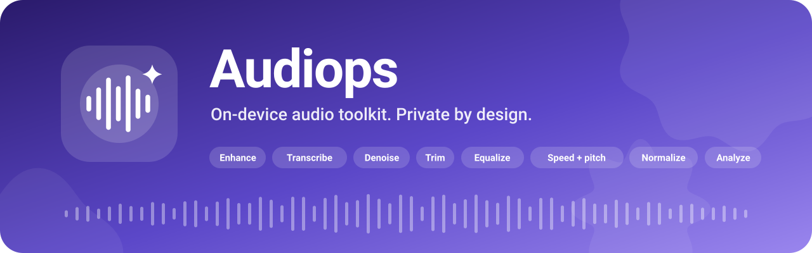
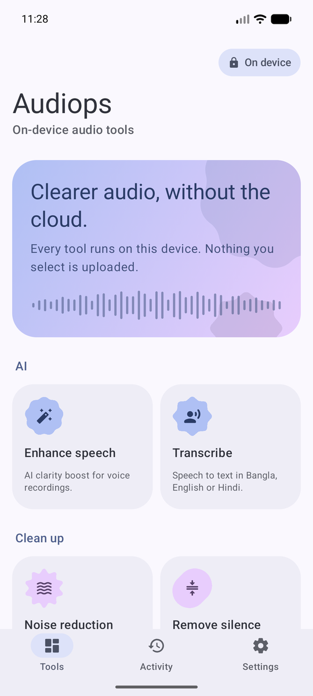
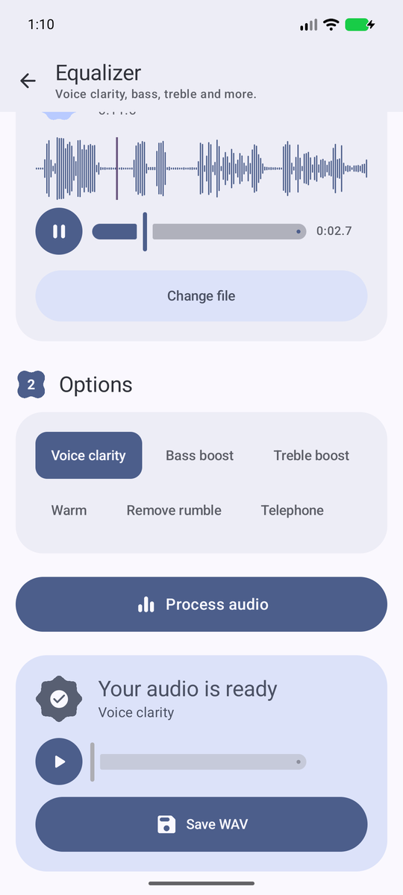
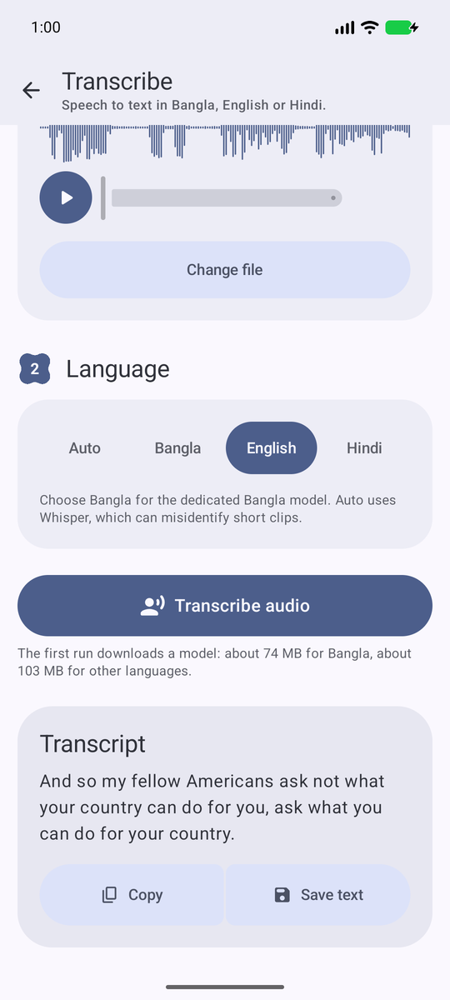
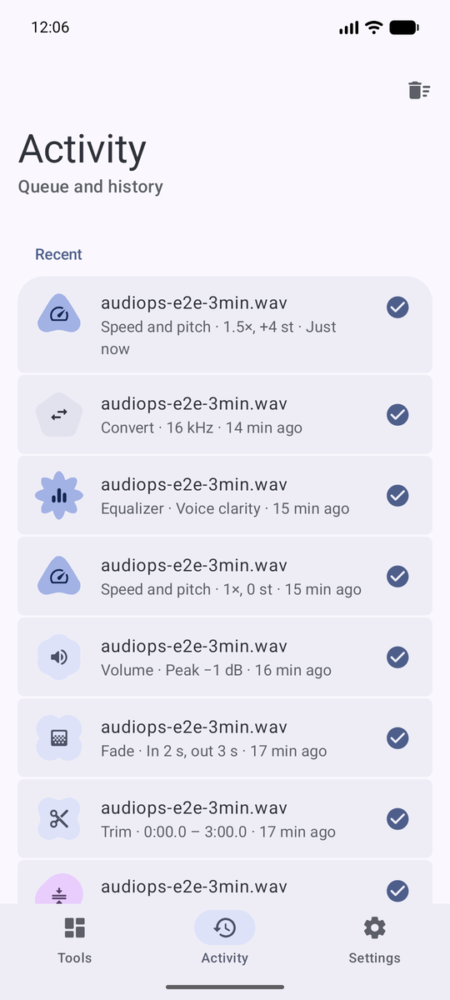
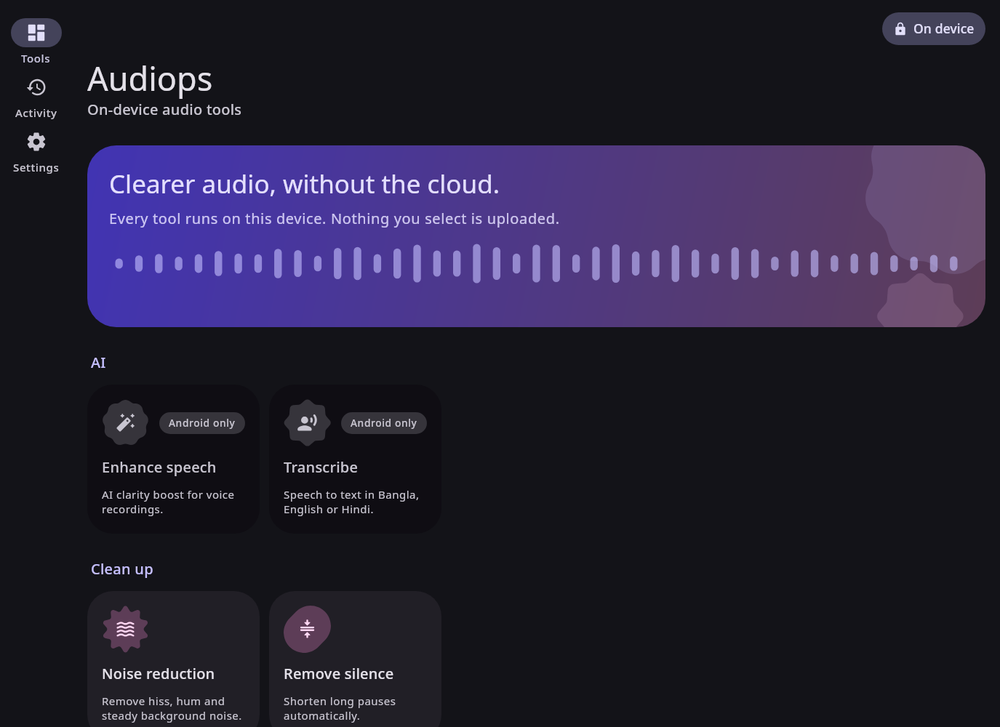
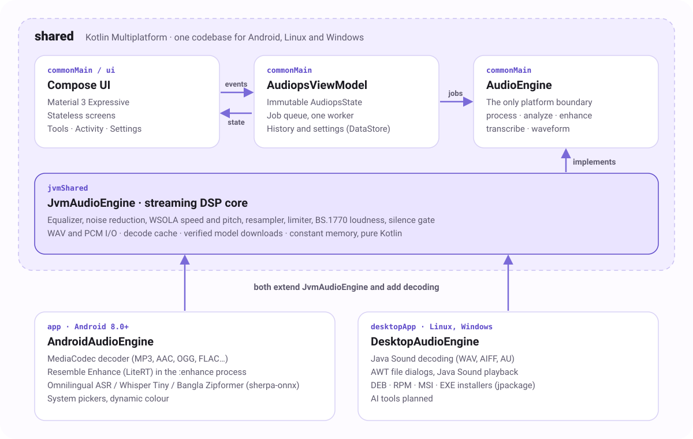

<div align="center">



<br>

[](https://github.com/sayedshaun/audiops/actions/workflows/android.yml) [](https://github.com/sayedshaun/audiops/releases) [](LICENSE)   

**Clean up, edit, transcribe and analyze audio, entirely on your device.**<br>
Nothing you open is uploaded. AI models download once, then run offline.

[**Download**](https://github.com/sayedshaun/audiops/releases/latest) · [Features](#features) · [Models](#models) · [Screenshots](#screenshots) · [Build from source](#build-from-source) · [Contributing](CONTRIBUTING.md)

</div>

---

## Why Audiops

- **Private by design.** Audio never leaves your device. The app has no accounts, no analytics and no server.
- **One toolkit, not ten apps.** Eleven tools behind one consistent interface, with a queue so several jobs can run while you keep working.
- **Built for long recordings.** Every tool streams audio in blocks, so a two-hour lecture uses the same memory as a voice note.
- **Open source, one codebase.** Kotlin Multiplatform and Compose Multiplatform power Android, Linux and Windows.

## Features

| | Tool | What it does |
| :-: | --- | --- |
| ✨ | **Enhance speech** | AI restoration of voice recordings ([Resemble Enhance](https://huggingface.co/SayedShaun/resemble-enhance-litert), LiteRT INT8). |
| 🗣️ | **Transcribe** | Speech to text in Bangla, English and Hindi (Whisper Tiny and [Bangla Zipformer](https://huggingface.co/SayedShaun/bangla-zipformer-onnx) on sherpa-onnx). |
| 🌊 | **Noise reduction** | Learns the noise from quiet passages and removes hiss, hum and steady background sound. |
| ⏸️ | **Remove silence** | Shortens long pauses and keeps natural padding. |
| ✂️ | **Trim** | Keep the part you need, chosen on the waveform. |
| 🌗 | **Fade** | Smooth fade in and fade out. |
| 🔊 | **Volume** | Peak normalization, loudness normalization to −14/−16/−23 LUFS (ITU-R BS.1770) with a look-ahead limiter, or plain gain. |
| ⏩ | **Speed and pitch** | 0.5×–2× tempo without changing pitch, ±12 semitones without changing tempo. |
| 🎚️ | **Equalizer** | Voice clarity, bass boost, treble boost, warm, remove rumble and telephone presets. |
| 🔁 | **Convert** | Anti-aliased resampling to 8, 16, 22.05, 44.1 or 48 kHz. |
| 📊 | **Analyze** | Integrated loudness, peak, RMS, clipping, silence and DC offset. |

Open MP3, AAC/M4A, WAV, FLAC, OGG and anything else your device decodes. Results are saved as WAV files (mono, 16-bit).

**And around the tools:** waveform previews and playback, an Activity tab with the job queue and history, light, dark and pure-black themes, dynamic color on Android 12+, predictive back, haptics, screen-reader labels and large touch targets.

## Models

Only the two AI tools use machine-learning models. Every other tool is classic signal processing written in Kotlin, with nothing to download.

| Tool (option) | Model | Runtime | Files | Download | License |
| --- | --- | --- | --- | --: | --- |
| **Enhance speech** | [Resemble Enhance](https://huggingface.co/SayedShaun/resemble-enhance-litert), INT8 LiteRT export | [LiteRT](https://ai.google.dev/edge/litert), CPU | 5 networks + mel filter bank | ~361 MB | MIT |
| **Transcribe** (Auto, English, Hindi) | [Whisper Tiny](https://huggingface.co/ippocode/indic-asr-onnx/tree/1f6243ec6dffc4de2db84fe1446576d1ff52c252/models/whisper-tiny), INT8 ONNX | [sherpa-onnx](https://github.com/k2-fsa/sherpa-onnx), CPU | encoder, decoder, tokens | ~104 MB | MIT (OpenAI Whisper weights) · Apache 2.0 (ONNX export) |
| **Transcribe** (Bangla) | [Bangla Zipformer](https://huggingface.co/SayedShaun/bangla-zipformer-onnx/tree/5442ca3d447572aaa5ef6913684d8f24d6d916cc), INT8 transducer | sherpa-onnx, CPU | encoder, decoder, joiner, tokens | ~74 MB | CC BY-SA 4.0 |
| All other tools | None | Kotlin DSP | – | – | – |

### Which model runs when

- **Enhance speech** always uses Resemble Enhance. Audio is converted to 44.1 kHz mono and processed in one-second chunks with 50% overlap through five networks: a **denoiser**, an **encoder**, a **flow-matching step** (16 midpoint steps, 32 evaluations), a **decoder** and a **vocoder** that produces the waveform. Long recordings go through in 20-second windows joined with a crossfade.
- **Transcribe** picks the model from the language you choose:
  - **Auto** uses Whisper Tiny with automatic language detection. It can misidentify very short clips.
  - **English** and **Hindi** use Whisper Tiny with the language fixed, which avoids detection mistakes.
  - **Bangla** uses the dedicated Bangla Zipformer, a model trained specifically for Bangla speech.

  Whisper reads 30-second sections with greedy decoding; Bangla Zipformer reads 20-second sections with beam search.

### Download, verification and storage

- Each model downloads **once**, on first use of its tool, over HTTPS from Hugging Face. After that the tool works fully offline.
- Every model file is pinned to a fixed revision and **verified with SHA-256** before use. When a model is updated, the old revision is deleted.
- Models live in app-private storage that is excluded from backups. See their size, or delete them, in **Settings → Storage → Downloaded models**; they download again when needed.
- **Memory:** Whisper and Bangla run comfortably on any supported phone. Resemble Enhance loads one network at a time, but its vocoder needs up to about 3 GB of free memory, so it is best on phones with 8 GB of RAM or more. It runs in a separate process: if a phone runs out of memory, Audiops stays open and says so.
- **Desktop:** the AI tools are Android-only for now (marked "Android only" in the app).

## Screenshots

<div align="center">






<sub>Tools · Equalizer with waveform and playback · Transcription · Activity history</sub>

<br><br>



<sub>The same app on desktop, with a navigation rail for wide windows</sub>

</div>

## Download

Get the latest build from [**Releases**](https://github.com/sayedshaun/audiops/releases/latest) and pick the file for your system:

| Platform | File | How to install |
| --- | --- | --- |
| Android 8.0+ | `-android-arm64-v8a.apk` (almost every phone since 2017) | Open it on your phone (allow installs from your browser or file manager). Not sure? Take `-android-universal.apk`, which works everywhere but is larger. |
| Linux (Debian, Ubuntu) | `.deb` | `sudo apt install ./audiops-*.deb` |
| Linux (Fedora, openSUSE) | `.rpm` | `sudo dnf install ./audiops-*.rpm` |
| Windows 10/11 | `.msi` or `-setup.exe` | Run the installer. |

Every release includes `SHA256SUMS.txt`. Verify a download with `sha256sum -c SHA256SUMS.txt --ignore-missing`.

### Platform support

| | Android | Linux / Windows |
| --- | :-: | :-: |
| Noise reduction, Remove silence, Trim, Fade, Volume, Speed and pitch, Equalizer, Convert, Analyze | ✅ | ✅ |
| AI Enhance and Transcribe | ✅ | Planned |
| Input formats | Anything the device decodes | WAV, AIFF, AU |

## Build from source

You need **JDK 17** (with `javac`) and the **Android SDK** with platform 37. Android Studio provides both.

```sh
git clone https://github.com/sayedshaun/audiops.git
cd audiops

./gradlew :app:installDebug          # Android, on a connected device or emulator
./gradlew :desktopApp:run            # desktop app
./gradlew :desktopApp:packageDistributionForCurrentOS   # .deb/.rpm on Linux, .msi/.exe on Windows
```

Point Gradle at the SDK with `ANDROID_HOME` or `local.properties`. Pass `-PaudiopsAbi=arm64-v8a` to build Android for a single ABI.

### Tests and code style

```sh
make hooks          # once per clone: format check and unit tests before every commit
make format         # format Kotlin and Gradle files (ktlint via Spotless)
make check          # format check + unit tests
make ci             # everything CI checks before a merge to main
make help           # all commands
```

The unit tests cover DSP correctness and speed, the job queue (ViewModel), history and settings storage, the history file format, WAV output, AI pre-processing maths, the desktop engine and off-screen UI renders. Every pull request to `main` must pass formatting, the unit tests, Android lint and the release build.

See [CHANGELOG.md](CHANGELOG.md) for what changed in each release.

## Architecture

<picture>
  <source media="(prefers-color-scheme: dark)" srcset="docs/images/architecture-dark.svg">
  
</picture>

- **`shared`**: the whole UI, state and the platform-neutral audio core. Screens are stateless (state in, events out); one ViewModel owns the job queue.
- **`app`**: the Android host and engine. AI enhancement runs in a separate process, so a memory kill can never close the app.
- **`desktopApp`**: the Linux and Windows host and engine, packaged with jpackage.

[AGENTS.md](AGENTS.md) covers the conventions, the design system and how to add a tool.

## Roadmap

- AI enhancement and transcription on desktop (sherpa-onnx JVM build), with broader desktop format support.
- Background processing with a foreground service and completion notifications.
- A lighter vocoder export, so AI enhancement fits phones with 4 GB of RAM.
- Translations (Bangla first).

Suggestions are welcome in [Issues](https://github.com/sayedshaun/audiops/issues).

## Contributing

Bug reports, ideas and pull requests are welcome. See [CONTRIBUTING.md](CONTRIBUTING.md) for setup, conventions and the release process.

## Acknowledgements

- [Resemble Enhance](https://github.com/resemble-ai/resemble-enhance) by Resemble AI (MIT) · [license](licenses/RESEMBLE-ENHANCE-MIT.txt)
- [Whisper](https://github.com/openai/whisper) by OpenAI (MIT) · [license](licenses/WHISPER-MIT.txt); Tiny INT8 ONNX export from [ippocode/indic-asr-onnx](https://huggingface.co/ippocode/indic-asr-onnx) (Apache 2.0)
- [sherpa-onnx](https://github.com/k2-fsa/sherpa-onnx) by k2-fsa (Apache 2.0) · [license](licenses/SHERPA-ONNX-APACHE-2.0.txt), with [ONNX Runtime](https://github.com/microsoft/onnxruntime) by Microsoft (MIT) · [license](licenses/ONNXRUNTIME-MIT.txt)
- [Bangla Zipformer](https://huggingface.co/SayedShaun/bangla-zipformer-onnx) (CC BY-SA 4.0) · [license](licenses/BANGLA-ZIPFORMER-CC-BY-SA-4.0.txt)
- [LiteRT](https://ai.google.dev/edge/litert) by Google (Apache 2.0)
- [JTransforms](https://github.com/wendykierp/JTransforms) and [JLargeArrays](https://gitlab.com/ICM-VisLab/JLargeArrays) (BSD 2-Clause) · [license](licenses/JTRANSFORMS-BSD-2-CLAUSE.txt), [license](licenses/JLARGEARRAYS-BSD-2-CLAUSE.txt); [Apache Commons Math](https://commons.apache.org/proper/commons-math/) (Apache 2.0) · [NOTICE](licenses/COMMONS-MATH3-NOTICE.txt)
- [Jetpack Compose](https://developer.android.com/compose), [Compose Multiplatform](https://www.jetbrains.com/compose-multiplatform/), AndroidX and Kotlin (Apache 2.0)

The app shows every license in full under **Settings → Open-source licenses → Third-party notices**.

## License

Audiops is licensed under the [Apache License 2.0](LICENSE). Copyright 2026 Sayed Shaun; see [`NOTICE`](NOTICE).

Third-party models and libraries keep their own licenses, listed above and in [`licenses/`](licenses).
