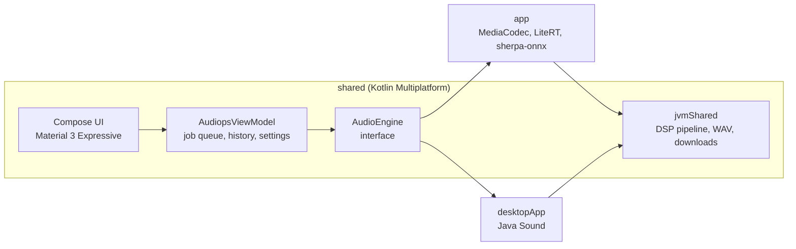

<div align="center">


<br>

[](https://github.com/sayedshaun/audiops/actions/workflows/android.yml) [](https://github.com/sayedshaun/audiops/releases)   

**Clean up, edit, transcribe and analyze audio, entirely on your device.**<br>
Nothing you open is uploaded. AI models download once, then run offline.

[**Download**](https://github.com/sayedshaun/audiops/releases/latest) · [Features](#features) · [Screenshots](#screenshots) · [Build from source](#build-from-source) · [Contributing](CONTRIBUTING.md)

</div>

---

## Why Audiops

- **Private by design.** Audio never leaves your device. The app has no accounts, no analytics and no server.
- **One toolkit, not ten apps.** Eleven tools behind one consistent interface, with a queue so several jobs can run while you keep working.
- **Built for long recordings.** Every tool streams audio in blocks, so a two-hour lecture uses the same memory as a voice note.
- **Open source, one codebase.** Kotlin Multiplatform and Compose Multiplatform power Android, Linux and Windows.

## Features

| | Tool | What it does |
| :-: | --- | --- |
| ✨ | **Enhance speech** | AI restoration of voice recordings ([Resemble Enhance](https://huggingface.co/SayedShaun/resemble-enhance-litert), LiteRT INT8). |
| 🗣️ | **Transcribe** | Speech to text in Bangla, English and Hindi (Whisper Tiny and [Bangla Zipformer](https://huggingface.co/SayedShaun/bangla-zipformer-onnx) on sherpa-onnx). |
| 🌊 | **Noise reduction** | Learns the noise from quiet passages and removes hiss, hum and steady background sound. |
| ⏸️ | **Remove silence** | Shortens long pauses and keeps natural padding. |
| ✂️ | **Trim** | Keep the part you need, chosen on the waveform. |
| 🌗 | **Fade** | Smooth fade in and fade out. |
| 🔊 | **Volume** | Peak normalization, loudness normalization to −14/−16/−23 LUFS (ITU-R BS.1770) with a look-ahead limiter, or plain gain. |
| ⏩ | **Speed and pitch** | 0.5×–2× tempo without changing pitch, ±12 semitones without changing tempo. |
| 🎚️ | **Equalizer** | Voice clarity, bass boost, treble boost, warm, remove rumble and telephone presets. |
| 🔁 | **Convert** | Anti-aliased resampling to 8, 16, 22.05, 44.1 or 48 kHz. |
| 📊 | **Analyze** | Integrated loudness, peak, RMS, clipping, silence and DC offset. |

Open MP3, AAC/M4A, WAV, FLAC, OGG and anything else your device decodes. Results are saved as WAV files (mono, 16-bit).

**And around the tools:** waveform previews and playback, an Activity tab with the job queue and history, light, dark and pure-black themes, dynamic color on Android 12+, predictive back, haptics, screen-reader labels and large touch targets.

## Screenshots

<div align="center">


<sub>Tools · Equalizer with waveform and playback · Transcription · Activity history</sub>

<br><br>


<sub>The same app on desktop, with a navigation rail for wide windows</sub>

</div>

## Download

Get the latest build from [**Releases**](https://github.com/sayedshaun/audiops/releases/latest). Each release contains:

| Platform | File | Notes |
| --- | --- | --- |
| Android 8.0+ | `audiops-<version>-android.apk` | Install directly (allow installs from your browser or file manager). |
| Linux (Debian, Ubuntu) | `audiops-<version>-linux-amd64.deb` | `sudo apt install ./audiops-<version>-linux-amd64.deb` |
| Linux (Fedora, openSUSE) | `audiops-<version>-linux-x86_64.rpm` | `sudo dnf install ./audiops-<version>-linux-x86_64.rpm` |
| Windows 10/11 | `audiops-<version>-windows-x64.msi` or `…-setup.exe` | Standard installer. |

Every release includes `SHA256SUMS.txt`. Verify a download with `sha256sum -c SHA256SUMS.txt --ignore-missing`.

### Platform support

| | Android | Linux / Windows |
| --- | :-: | :-: |
| Noise reduction, Remove silence, Trim, Fade, Volume, Speed and pitch, Equalizer, Convert, Analyze | ✅ | ✅ |
| AI Enhance and Transcribe | ✅ | Planned |
| Input formats | Anything the device decodes | WAV, AIFF, AU |

## Build from source

You need **JDK 17** (with `javac`) and the **Android SDK** with platform 37. Android Studio provides both.

```sh
git clone https://github.com/sayedshaun/audiops.git
cd audiops

./gradlew :app:installDebug          # Android, on a connected device or emulator
./gradlew :desktopApp:run            # desktop app
./gradlew :desktopApp:packageDistributionForCurrentOS   # .deb/.rpm on Linux, .msi/.exe on Windows
```

Point Gradle at the SDK with `ANDROID_HOME` or `local.properties`. Pass `-PaudiopsAbi=arm64-v8a` to build Android for a single ABI.

### Tests

```sh
./gradlew :shared:desktopTest   # DSP correctness and performance, WAV, chunking, model maths
./gradlew :desktopApp:test      # desktop engine and off-screen UI renders
./gradlew :app:lintDebug        # Android lint
```

## Architecture



- **`shared`**: the whole UI, state and the platform-neutral audio core. Screens are stateless (state in, events out); one ViewModel owns the job queue.
- **`app`**: the Android host and engine. AI enhancement runs in a separate process, so a memory kill can never close the app.
- **`desktopApp`**: the Linux and Windows host and engine, packaged with jpackage.

[AGENTS.md](AGENTS.md) covers the conventions, the design system and how to add a tool.

## Roadmap

- AI enhancement and transcription on desktop (sherpa-onnx JVM build), with broader desktop format support.
- Background processing with a foreground service and completion notifications.
- A lighter vocoder export, so AI enhancement fits phones with 4 GB of RAM.
- Translations (Bangla first).

Suggestions are welcome in [Issues](https://github.com/sayedshaun/audiops/issues).

## Contributing

Bug reports, ideas and pull requests are welcome. See [CONTRIBUTING.md](CONTRIBUTING.md) for setup, conventions and the release process.

## Acknowledgements

- [Resemble Enhance](https://github.com/resemble-ai/resemble-enhance) by Resemble AI (MIT) · [license](licenses/RESEMBLE-ENHANCE-MIT.txt)
- [sherpa-onnx](https://github.com/k2-fsa/sherpa-onnx) by k2-fsa (Apache 2.0) · [license](licenses/SHERPA-ONNX-APACHE-2.0.txt)
- Whisper Tiny INT8 export from [ippocode/indic-asr-onnx](https://huggingface.co/ippocode/indic-asr-onnx)
- [Bangla Zipformer](https://huggingface.co/SayedShaun/bangla-zipformer-onnx) (CC BY-SA 4.0) · [license](licenses/BANGLA-ZIPFORMER-CC-BY-SA-4.0.txt)
- [JTransforms](https://github.com/wendykierp/JTransforms), [Jetpack Compose](https://developer.android.com/compose) and [Compose Multiplatform](https://www.jetbrains.com/compose-multiplatform/)

## License

A license for Audiops' own source code has not been chosen yet. Until one is added, the code is visible but not licensed for reuse. Third-party models and libraries keep their own licenses, listed above and in [`licenses/`](licenses).
